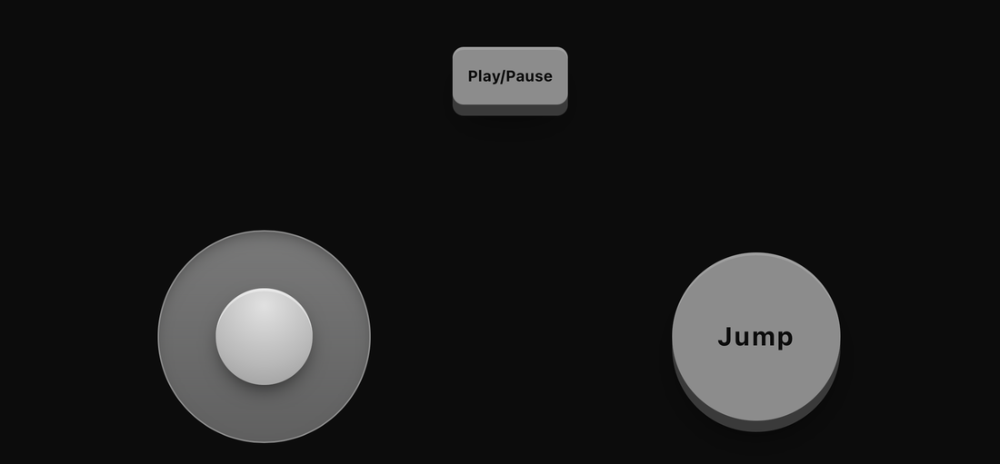
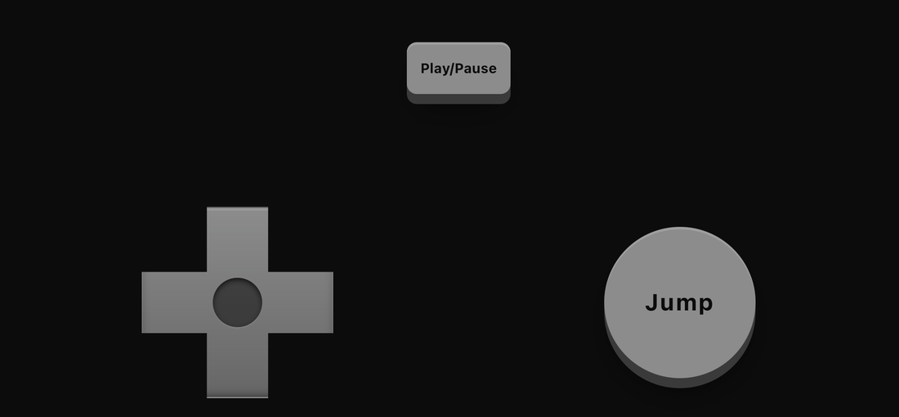
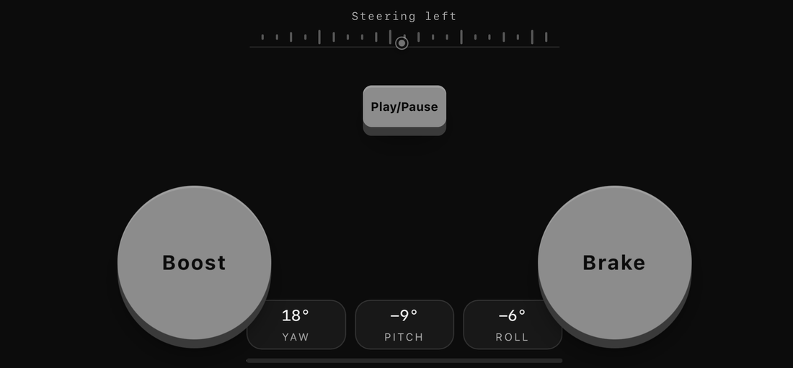

# mobControl

Turn a phone into a controller for your web game. Players scan a QR code and use buttons, a thumbstick, a D-pad, or motion controls in their phone browser.

You choose the controls and bind them to your game. mobControl serves the phone interface, pairs the devices, and sends input over WebSockets.

Coding agents can start with the [integration guide](mobcontrol/AGENT_README.md), also included at the root of the npm package.

## Quick start

Once mobControl is published, install it in a Node project. This example uses Express.

```sh
npm install mobcontrol express
```

**1. Create `server.cjs`**

```js
const express = require('express');
const { createServer } = require('node:http');
const { attachPhoneController } = require('mobcontrol');

const app = express();
const server = createServer(app);

app.use(attachPhoneController(server).middleware);
app.use(express.static('public'));
server.listen(3000);
```

**2. Create `public/index.html`**

```html
<!doctype html>
<meta charset="utf-8">
<title>mobControl quick start</title>
<div id="qr"></div>
<p id="status">Scan the QR code to connect.</p>

<script type="module">
  import { PhoneController } from '/__phone/controller.js';

  const pad = new PhoneController({ buttons: [{ id: 'jump', label: 'Jump' }] });
  const status = document.querySelector('#status');

  pad.mountQR(document.querySelector('#qr'));
  pad.on('pair', () => { status.textContent = 'Connected. Tap Jump.'; });
  pad.on('press', ({ id }) => {
    if (id === 'jump') status.textContent = 'Jump pressed!';
  });
</script>
```

**3. Pair your phone**

Run `node server.cjs`. With both devices on the same Wi-Fi, open `http://<computer-LAN-IP>:3000` on your computer and scan the QR code. Tap **Jump** on the phone. The game page should show **Jump pressed!**

## Connect it to your game

### Phone layouts

| Cube Run · Joystick | Cube Run · D-pad | Tilt Flyer · Motion |
| --- | --- | --- |
|  |  |  |

Games can also declare a **drag surface** for gestures such as pushing a puck.

| Input | What your game reads |
| --- | --- |
| Button | Listen for `press` and `release`, or read `pad.button.jump` while held. |
| Stick or D-pad | Read `pad.stick.move.x` and `pad.stick.move.y` for a control named `move`. |
| Drag | Declare a `drag` control and listen for `dragmove` to read position and velocity. |
| Tilt | Map a signal with `axes: { x: 'roll' }`, then read `pad.axis.x`. |
| Shake | Read `pad.shake` for shake intensity. Set `motion: true` to use shake without tilt calibration. |

Set `haptic: true` on a button to flash it and request a short vibration on each press. For a game event like a collision, call `pad.vibrate(60)` for a 60 ms pulse. Vibration depends on browser and device support.

Use `layouts` from the same browser module to start from a preset. See [Cube Run](examples/cube-run/README.md) for a working example that shares movement and jump logic between the keyboard and phone.

The controller defaults to landscape and rotates its interface when needed, even with phone auto-rotate locked. Set `orientation: 'portrait'` for a portrait controller or `orientation: 'any'` to follow the phone.

### Read accelerometer and gyroscope data

Set `motion: true` to request device motion over HTTPS. Before sharing readings, the phone tells the player what the paired game will receive and asks them to tap **Enable motion**. For display-relative motion, read `pad.controllerMotion`:

```js
const pad = new PhoneController({ motion: true });

pad.on('input', () => {
  const { acceleration, rotationRate } = pad.controllerMotion ?? {};
  // acceleration?.right/up/out are m/s² toward the controller's
  // displayed right edge/top edge/out of screen.
  // rotationRate?.right/up/out are degrees/s around those axes.
});
```

`pad.controllerMotion` is `null` until a sample is available; each reading can also be `null`. Its `right`, `up`, and `out` directions follow the controller display, including when the interface rotates. If the browser does not report display angle, the relative sample may be unavailable. For advanced uses, `pad.motion` retains the raw physical X/Y/Z readings. Use `axes` for calibrated tilt steering.

Test on a phone over HTTPS with rotation lock both on and off: enable motion, rotate the phone, and confirm controller-relative directions continue to follow the displayed controller. The raw `pad.motion` axes remain tied to the phone's physical axes.

When a game offers a joystick and motion as alternatives, the phone starts with the joystick and shows a **Motion** toggle. Set `motionWithJoystick: true` when the game needs both at once. The player gets the permission prompt and the joystick stays available during motion play. Read `pad.motionEnabled` to tell which mode is active.

### Check a controller configuration

Import `configurationContract` and `validateConfiguration` from `/__phone/controller.js` in the browser, or from `mobcontrol/client/shared/config.js` in Node using an ES module import. The contract lists supported options and input bindings. Pass the same options you would give to `new PhoneController(options)` to `validateConfiguration(options)`. It returns an empty array on success or issues with a field path and a message.

For coding agents, the [optional MCP companion](tools/mobcontrol-mcp/README.md) lists capabilities and validates a controller configuration against the mobControl version installed in the game.

## Try the demos from this repository

Run `npm install` from the repository root, then choose a demo.

| Command | Demo |
| --- | --- |
| `npm run cube` | [Cube Run](examples/cube-run/README.md), a platformer on port 3200. |
| `npm run flyer` | [Tilt Flyer](examples/tilt-flyer/README.md), a motion-controlled flight demo on port 3000. |
| `npm run shuffleboard` | [Shuffleboard](examples/shuffleboard/README.md), a one-puck drag demo on port 3400. |
| `npm run dodge` | [Block Dodge](examples/block-dodge/README.md), a keyboard-first game with phone reconnect and fallback on port 3300. |

Touch controls work over local HTTP. Use HTTPS for motion controls and open the HTTPS URL on your computer before scanning the QR. For public hosting, enable WebSocket upgrades and add room access controls. The built-in relay lets a new connection replace an existing connection in the same room and role.

[MIT license](LICENSE)
