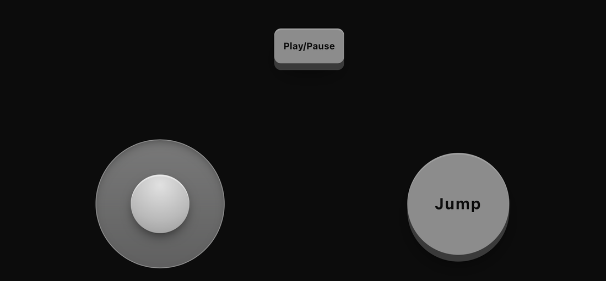
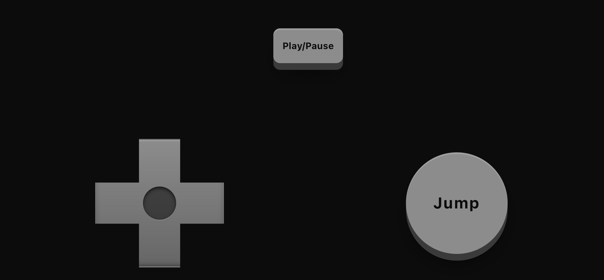
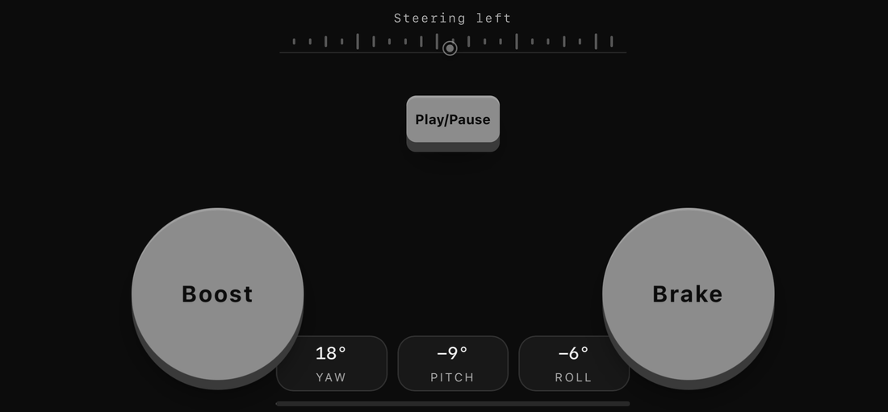

# mobControl

Turn a phone into a controller for your web game. Players scan a QR code and use buttons, a thumbstick, a D-pad, or motion controls in their phone browser. Your game chooses the controls and responds to the input.

## Quick start

Install mobControl and Express in your Node project:

```sh
npm install mobcontrol express
```

Create `server.cjs`:

```js
const express = require('express');
const { createServer } = require('node:http');
const { attachPhoneController } = require('mobcontrol');

const app = express();
const server = createServer(app);

app.use(attachPhoneController(server).middleware);
app.use(express.static('public'));
server.listen(process.env.PORT || 3000);
```

Create `public/index.html`:

```html
<!doctype html>
<html lang="en">
<meta charset="utf-8">
<meta name="viewport" content="width=device-width, initial-scale=1">
<title>mobControl quick start</title>
<div id="qr"></div>
<p id="status">Scan the QR code to connect.</p>

<script type="module">
  import { PhoneController } from '/__phone/controller.js';

  const pad = new PhoneController({ buttons: [{ id: 'jump', label: 'Jump' }] });
  const status = document.querySelector('#status');

  pad.mountQR(document.querySelector('#qr'));
  pad.on('pair', () => { status.textContent = 'Connected. Tap Jump.'; });
  pad.on('press', ({ id }) => {
    if (id === 'jump') status.textContent = 'Jump pressed!';
  });
</script>
</html>
```

Run `node server.cjs`. Keep the computer and phone on the same Wi-Fi, open `http://<computer-LAN-IP>:<port>` on the computer, then scan the QR code with your phone. Tap **Jump**; the game page will show **Jump pressed!** Touch controls work over local HTTP. Motion controls require HTTPS.

## Cloudflare hosting

For games hosted on Cloudflare Pages or Workers, follow the [Cloudflare setup guide](cloudflare/README.md) to connect the game to the MobControl relay.

## Phone layouts

| Cube Run · Joystick | Cube Run · D-pad | Tilt Flyer · Motion |
| --- | --- | --- |
|  |  |  |

The controller also supports a **drag surface** for gestures such as pushing a puck. Declare a `drag` control and listen for `dragmove` to read the touch position and velocity. Buttons emit `press` and `release`; sticks and D-pads report axes; motion controls can map tilt to axes.

See the [integration guide for coding agents](AGENT_README.md) for control options and input details. Browse the [repository demos](https://github.com/pwnsbd/mobControl/tree/main/examples) for complete games, including [Cube Run](https://github.com/pwnsbd/mobControl/tree/main/examples/cube-run).

[MIT license](LICENSE)
